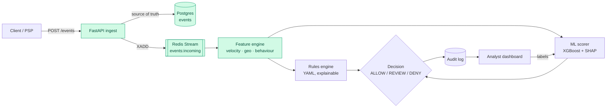

# Payment Fraud Detection Engine

A real-time payment fraud detection engine built from scratch: event ingestion, streaming
feature computation, an explainable rules engine and an ML risk scorer, aiming to return
`ALLOW` / `REVIEW` / `DENY` for every payment in under 100 ms.

> **Status:** Milestones 1–2 of 7 complete — event ingestion, a labelled synthetic traffic
> generator, and a streaming feature engine. See the [roadmap](#roadmap).


## Why I'm building this

I work in fraud and risk operations, investigating suspicious transactions by hand. This
project is the system I'd want behind that work: one that catches card testing, cloned
cards and account takeovers automatically, and explains *why* it flagged something so an
analyst can act on it in seconds.

## Architecture



Green = built. The rest is on the roadmap below.

## Milestone 1 results

Measured on a single development machine against real PostgreSQL and Redis:

| Check | Result |
|---|---|
| 10,000-event replay (batches of 500) | 10,000 accepted, **0 validation errors**, ~4,100 events/s |
| Single-event ingest latency | **3.9 ms p50 · 5.5 ms p95** |
| Re-sending the same events | All detected as duplicates, nothing published twice |
| Test suite | 58 tests, runs in ~1 s without Docker |

## Milestone 2 results

A worker reads `events:incoming` through a Redis consumer group and computes 35 signals per
event: velocity counters, per-user spending baselines, geo and network checks, and card
history.

| Check | Result |
|---|---|
| Feature computation, all 35,961 events of a 30-day dataset, real Redis | **2.0 ms p50 · 4.7 ms p95** (target < 10 ms) |
| Worker throughput, 10,000 events end to end into Postgres | ~420 events/s, one worker |
| Replay of the same events on fresh state | Identical vectors (windows use event time, not wall clock) |
| Worker crash before acknowledging | Entries stay pending and are reprocessed; no double counting |

How it works:

- **Velocity windows are Redis sorted sets scored by event time.** "Payments on this card
  in the last 5 minutes" is a `ZCOUNT` over `[t − 300 s, t]`, where `t` is the event's own
  timestamp. Replaying last month's data gives the same answers it would have given live.
- **Two pipelined round trips per event.** The first records the event in the velocity sets
  and reads prior state; the second folds the event into the user's baselines. Baselines are
  read *before* the update, so an amount is compared with history that doesn't include it.
- **Idempotent.** Set members are event or card ids, and each computed vector is cached
  under the event id, so a redelivered event returns the same vector without being counted
  twice.
- **Out-of-order and skewed clocks are handled explicitly:** impossible travel uses the
  absolute time gap with a one-minute floor, first-seen times only ever move earlier, and a
  card's age can't go negative.

## Design decisions

- **No real card data, ever.** `card_id` must be a token (`tok_…`). The schema detects raw
  card numbers (13–19 digits passing the Luhn checksum) even with spaces, dashes or a
  `tok_` prefix, and rejects them. Validation errors deliberately **don't echo the input
  back**, so a mistakenly sent card number never ends up in client logs.
- **Strict contract.** Unknown fields are rejected (`extra="forbid"`), timestamps must be
  timezone-aware, and events more than 5 minutes in the future are refused (clock-skew
  tolerance).
- **Idempotent ingestion.** `event_id` is the primary key; retries are safe.
- **Persist first, then publish.** Postgres is the source of truth. If Redis is down the
  insert is rolled back and the API returns 503, so the client's retry isn't mistaken for a
  duplicate.
- **One ordered stream for all event types.** Detecting card testing ("3 cards added, then a
  burst of tiny charges") needs card-added and payment events in true arrival order.
- **Labels never travel with events.** The generator writes ground truth to a separate file,
  so the engine can't learn from leaked labels.

## Synthetic data

No public dataset has the mix of signals this engine needs, so `fraud-gen` simulates it.
500 users over 30 days gives about 36,000 events, 5% of them fraudulent.

Normal users get a home city, one to three long-standing cards, active hours, a personal
spending mix and realistic noise: domestic trips, a mistyped CVV followed by a successful
retry, occasional late-night orders, the odd legitimate gift-card purchase. That noise
matters, because a good engine has to tell it apart from real attacks.

| Injected pattern | What happens |
|---|---|
| **Card testing** | Throwaway account on a datacenter IP adds 3–6 stolen cards, probes each with ₹1–₹99 charges (mostly declined), cashes out the live ones on gift cards |
| **CVV brute force** | 5–10 `incorrect_cvv` declines on one card within minutes, then an approved high-value electronics purchase |
| **Impossible travel** | Cardholder pays at home; 10–90 minutes later the cloned card is swiped abroad |
| **Amount spike** | New card added to a victim's account between 1 and 5 am IST, then a purchase 20–80× their normal spend on gift cards or crypto |
| **Account takeover** | New device on a foreign hosting IP drains the victim's existing card via transfers and gift cards |

The output is deterministic for a given `--seed`.

## Quickstart

**With Docker:**

```bash
docker compose up -d --build              # Postgres + Redis + API on :8000 + worker
pip install -e .                          # installs the fraud-gen CLI
fraud-gen generate --users 500 --days 30 --out data/
fraud-gen replay --file data/events.jsonl --limit 10000
```

Open http://localhost:8000/docs for interactive API docs.

**Tests only (no Docker needed):**

```bash
pip install -e ".[dev]"
pytest
```

## API

| Method | Path | Purpose |
|---|---|---|
| `POST` | `/events/payment` | Ingest one payment attempt |
| `POST` | `/events/instrument` | Ingest a card added / updated / removed |
| `POST` | `/events/batch` | Up to 1,000 mixed events, order preserved |
| `GET` | `/events/{event_id}` | Fetch a stored event |
| `GET` | `/features/{event_id}` | The feature vector the worker computed for an event |
| `GET` | `/health` | Postgres and Redis status |

```bash
curl -X POST localhost:8000/events/payment -H 'content-type: application/json' -d '{
  "user_id": "usr_alice01", "card_id": "tok_a1b2c3d4e5f6", "device_id": "dev_phone01",
  "ip_address": "49.37.12.8", "timestamp": "2026-10-20T09:30:00+05:30",
  "amount": "1499.00", "currency": "INR",
  "merchant_id": "mer_grocery_001", "merchant_category": "grocery",
  "geo": {"lat": 12.97, "lon": 77.59, "country": "IN", "city": "Bengaluru"}
}'
# → 202 {"event_id": "...", "stream_id": "1729416600000-0", "status": "accepted"}
```

## Roadmap

- [x] **1. Event ingestion & schema** — FastAPI, Postgres, Redis Streams, synthetic generator
- [x] **2. Feature engine** — velocity counters (Redis sorted sets), amount z-scores,
      impossible travel, IP/BIN country mismatch, card age
- [ ] **3. Rules engine** — YAML rules with human-readable reasons
- [ ] **4. ML risk scorer** — XGBoost + Isolation Forest, SHAP explanations
- [ ] **5. Decision service & audit log** — <100 ms end to end, Prometheus metrics
- [ ] **6. Analyst dashboard** — Next.js review queue with a label feedback loop
- [ ] **7. Write-up & demo**

## Project layout

```
src/fraud_engine/
  schemas.py      event contracts + card-number detection
  api.py          ingest routes
  scoring_api.py  read-side routes (features)
  db.py           Postgres tables
  stream.py       Redis Streams publisher and consumer-group reader
  features/       feature catalogue, Redis feature engine, geo, IP/BIN reference data
  pipeline.py     per-event stages, timed
  worker.py       stream worker: batch, process in order, persist, acknowledge
  cli.py          fraud-engine worker | bench-features
  main.py         app factory
  generator/      personas, fraud patterns, CLI
tests/            schema, API, generator, feature and worker tests
```

## Tech

Python 3.11+ · FastAPI · Pydantic v2 · SQLAlchemy 2 (async) · PostgreSQL · Redis Streams ·
pytest · Ruff · Docker · GitHub Actions

---

Built by [Adarsh Puthane](https://adarshputhane.com) ·
[LinkedIn](https://www.linkedin.com/in/adarshputhane/)
