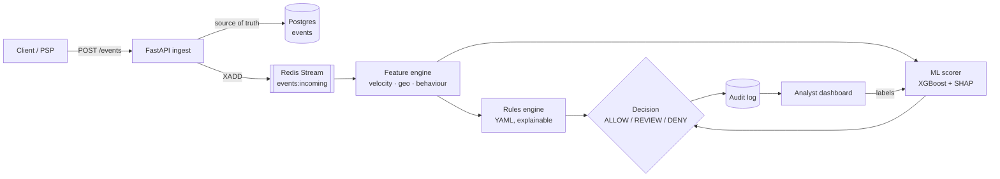
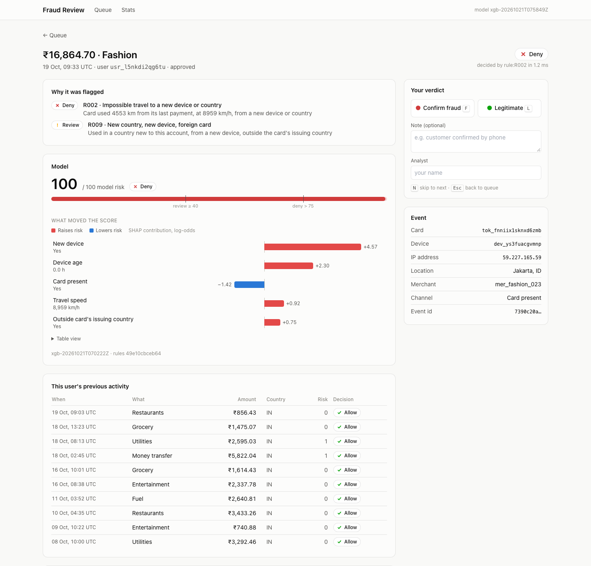
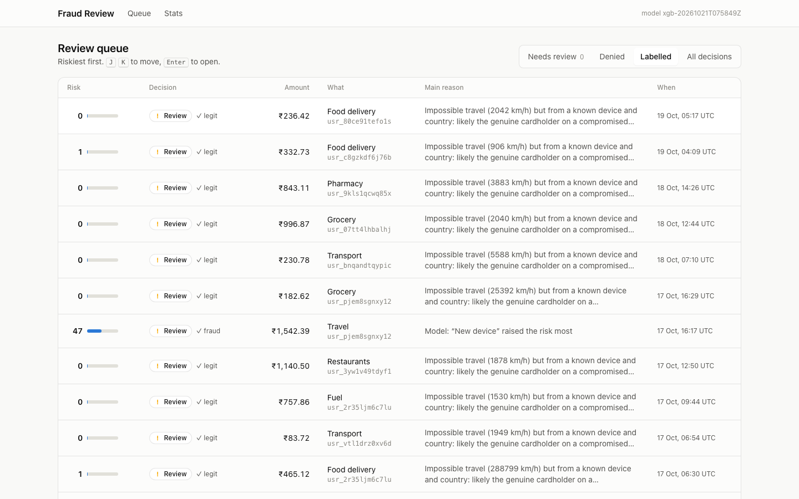
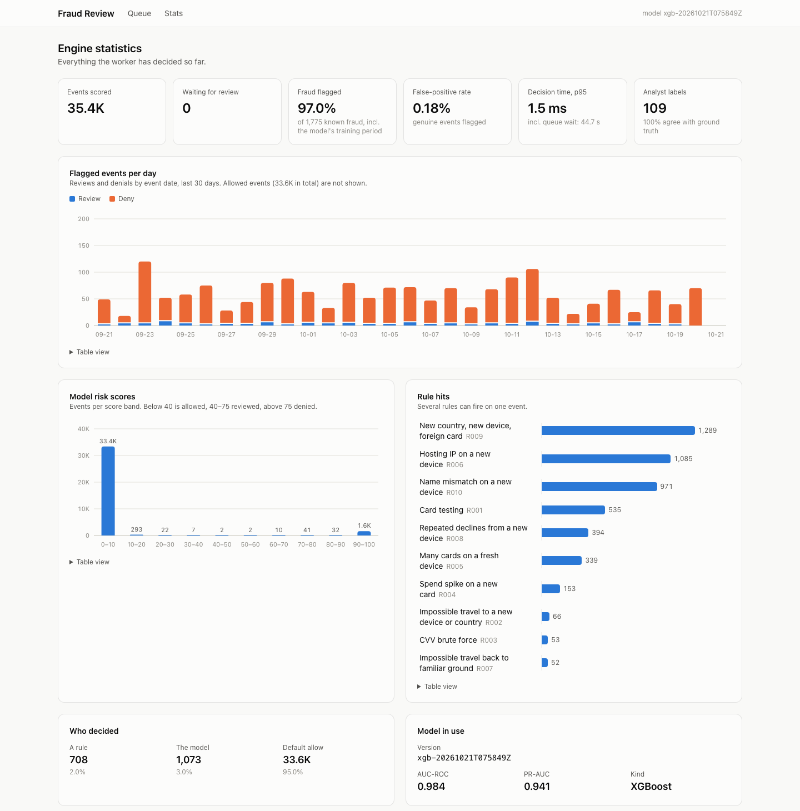

# Payment Fraud Detection Engine

A real-time payment fraud detection engine built from scratch: event ingestion, streaming
feature computation, explainable rules, a calibrated ML risk scorer with SHAP explanations,
an audit log every decision can be re-derived from, and an analyst dashboard whose verdicts
retrain the model. It returns `ALLOW`, `REVIEW` or `DENY` for each payment in about 3 ms.


## Results at a glance

| | Result | Target |
|---|---|---|
| Fraud flagged on held-out data (model) | **90.2%** at a **0.01%** false-positive rate, AUC 0.984 | AUC ≥ 0.90 |
| Fraud flagged by the rules alone (all data) | **90.9%** at a **0.17%** false-positive rate | ≥ 80% at < 2% |
| Decision time, steady 100 events/s | **3.2 ms** p95, publish to decision | < 100 ms |
| Throughput, one worker | **730** decisions/s | ≥ 100/s |
| Feature computation · model scoring with SHAP | **4.9 ms** · **0.33 ms** p95 | < 10 ms · < 30 ms |
| Decisions re-derived from the audit log | **33,000 of 33,000** identical | all |
| Analyst triage | keyboard-only; 8.7 ms of system time per case | < 30 s per case |

Measured on synthetic data (500 customers, 30 days, 35,421 events, 5% fraud), which is
cleaner than real traffic: treat the detection numbers as an upper bound.

**Read more:** [the write-up](docs/writeup.md) ·
[every signal and why it exists](docs/signals.md) ·
[an example model comparison report](docs/example-model-comparison.md)

## Why I'm building this

I work in fraud and risk operations, investigating suspicious transactions by hand. This
project is the system I'd want behind that work: one that catches card testing, cloned
cards and account takeovers automatically, and explains *why* it flagged something so an
analyst can act on it in seconds.

## Architecture



## Ingestion

Measured on a single development machine against real PostgreSQL and Redis:

| Check | Result |
|---|---|
| 10,000-event replay (batches of 500) | 10,000 accepted, **0 validation errors**, ~4,100 events/s |
| Single-event ingest latency | **3.9 ms p50 · 5.5 ms p95** |
| Re-sending the same events | All detected as duplicates, nothing published twice |
| Test suite | 158 Python tests in ~12 s without Docker; dashboard lint, type-check and build in CI |

## Streaming features

A worker reads `events:incoming` through a Redis consumer group and computes 35 signals per
event: velocity counters, per-user spending baselines, geo and network checks, and card
history.

| Check | Result |
|---|---|
| Feature computation, all 35,421 events of a 30-day dataset, real Redis | **2.5 ms p50 · 4.9 ms p95** (target < 10 ms); 0.7 ms p50 inside the Docker network |
| Replay of the same events on fresh state | Identical vectors (windows use event time, not wall clock) |
| Worker crash before acknowledging | Entries stay pending and are reprocessed; no double counting |

How it works:

- **Velocity windows are Redis sorted sets scored by event time.** "Payments on this card
  in the last 5 minutes" is a `ZCOUNT` over `[t − 300 s, t]`, where `t` is the event's own
  timestamp. Replaying last month's data gives the same answers it would have given live.
- **Two pipelined round trips per event.** The first records the event in the velocity sets
  and reads prior state; the second folds the event into the user's baselines. Baselines are
  read *before* the update, so an amount is compared with history that doesn't include it.
- **Idempotent.** Set members are event or card ids, and each computed vector is cached
  under the event id, so a redelivered event returns the same vector without being counted
  twice.
- **Out-of-order and skewed clocks are handled explicitly:** impossible travel uses the
  absolute time gap with a one-minute floor, first-seen times only ever move earlier, and a
  card's age can't go negative.

All 35 signals, with the reasoning behind each: [docs/signals.md](docs/signals.md).

## Explainable rules

Rules live in [`default_rules.yml`](src/fraud_engine/rules/default_rules.yml): readable by
an analyst, hot-reloaded when the file changes, and every hit carries a sentence explaining
it, e.g. *"Card used 4540 km from its last payment, at 5988 km/h, from a new device or
country"*.

Measured on all 35,421 labelled events (1,775 fraudulent):

| Ruleset | Recall | False-positive rate | DENY false-positive rate |
|---|---|---|---|
| Starter rules R001–R006 from the plan | 74.3% | 0.30% | 0.15% |
| **After error analysis (R001–R010)** | **90.9%** | **0.17%** | **0.01%** |

Target: ≥ 80% recall at < 2% false positives. The starter rules miss it; error analysis
closes the gap. The remaining misses are account takeovers on the victim's own device
(76% caught) and friendly fraud (0%, by design).

What the error analysis found:

- **Most false alarms from the impossible-travel rule were genuine cardholders paying at
  home minutes after a fraudster used their card abroad.** Relative to the fraud, the genuine
  purchase looks like impossible travel. The rule is right that the card is compromised, but
  denying the real customer is the wrong call. Impossible travel is now split: to a *new*
  device or country is DENY (R002); back to a familiar device and country is REVIEW (R007).
- **"Four cards on one device" also fired on people who simply own four cards.** It now
  needs a device first seen in the last 72 hours (R005), which is what a carding rig looks
  like.
- **The misses shared one fingerprint**: a device new to the account combined with a new
  country and a foreign-issued card (R009), repeated declines (R008), or a cardholder-name
  mismatch (R010).
- `amount_zscore` is computed on log amounts, because spending is heavy-tailed; a threshold
  of 5 on that scale missed most spend spikes, so R004 uses 3 or "≥ 5× typical spend".

Safety: conditions are parsed with Python's `ast` and checked against an allow-list
(comparisons, `and`/`or`/`not`, feature names, literals); nothing reaches `eval()`. Unknown
feature names fail at load time, and a broken edit leaves the last good ruleset running.

## ML risk scoring

An XGBoost classifier scores every event 0–100, with the five features that pushed the score
most (exact TreeSHAP values). Trained on the oldest 60% of events, calibrated on the next 20%,
and **every number below is from the newest 20%, which the model never saw** — the way it
would be deployed.

| On the 7,085 held-out events (316 fraudulent) | Recall | False-positive rate | Precision |
|---|---|---|---|
| Rules alone | 87.0% | 0.21% | 95.2% |
| **XGBoost alone** (score ≥ 40) | **90.2%** | **0.01%** | 99.7% |
| Combined decision, DENY only | 89.6% | 0.00% | 100% |
| Isolation Forest, no labels (cold-start fallback) | 63.3% | 0.00% | 100% |

| Check | Result | Target |
|---|---|---|
| AUC-ROC, held out | **0.984** (PR-AUC 0.941) | ≥ 0.90 |
| Scoring latency incl. SHAP, single event | **0.33 ms p95** | < 30 ms |
| Calibration (Brier score) | 0.0043 | — |

- **Class imbalance:** fraud is 5% of events; `scale_pos_weight` ≈ 19 stops the model from
  scoring everything as legitimate.
- **Calibrated scores:** reweighting inflates raw probabilities on purpose, so they are
  re-mapped with Platt scaling on the held-out calibration period. On the test period,
  events scored 5–20 averaged 8.4 and were 9.4% fraud; events scored 90+ averaged 99.4 and
  were all fraud. The middle of the range holds too few events (2–7 per band) to verify, a
  consequence of how cleanly the model separates the classes.
- **Where the model beats the rules:** account takeovers, 83% vs 69% on the same held-out
  events (a small sample: 42), most of them on the victim's own device, which no device or
  location rule can see. 23 of the 316 test fraud events are friendly fraud, which nothing
  can catch, so the ceiling is about 92.7%.
- **Explanations:** XGBoost's built-in TreeSHAP (`pred_contribs=True`), exact and additive
  (contributions + bias = the model's output, checked in the tests), without pulling in the
  `shap` package.
- **Safe model files:** XGBoost's own JSON format and calibration parameters as JSON; no
  pickle for the main model. Versions live side by side in `models/`; `CURRENT` names the
  active one and running services swap to a newly promoted version without a restart.

## Decisions and the audit log

The full stack running in Docker (API and worker containers built from the `Dockerfile`):

| Check | Result | Target |
|---|---|---|
| Throughput, one worker, 30,000-event burst | **730 decisions/s** | ≥ 100/s |
| End to end at a steady 100 events/s (publish → decision) | **2.6 ms p50 · 3.2 ms p95 · 4.5 ms p99** | < 100 ms |
| Processing per event: features · rules · model | 0.7 · 0.01 · 0.4 ms (p50) | — |
| Decisions recomputed from the audit log | **33,000 / 33,000 identical** | all reconstructable |

**Decision hierarchy**, strongest first: a rule DENY always wins; a model score above 75
denies; a rule REVIEW or a score of 40 or more goes to an analyst (a low score never cancels
a rule's review); otherwise ALLOW. The audit row records which stage decided
(`rule:R002`, `model` or `default`).

**Reconstructable, not just logged.** Each decision row stores the fired rules with their
reasons, the model score and SHAP top 5, the ruleset version, the model version, the
thresholds in force and per-stage timings. Every ruleset version used is saved in a
`rulesets` table, and model versions stay on disk. `fraud-engine audit` re-runs the stored
feature vector through exactly that ruleset, model and thresholds and compares field by
field; tampering with a stored decision is caught (there's a test for it).

**Latency accounting.** A Redis stream id starts with the millisecond it was published, so
the worker records how long each event *waited* as well as how long it *took*. During the
burst test events queued for up to 40 s behind the backlog: that's throughput, not latency,
and the `fraud_latency_budget_exceeded_total` counter shows exactly that.

**Metrics** (Prometheus): ingest outcomes, decisions by outcome and source, rule hits,
per-stage and end-to-end latency histograms, persist time, dead-lettered events and the
model version in use. The API serves `/metrics`; the worker serves `:9100/metrics`;
`docker compose --profile monitoring up -d` adds a Prometheus server on
[localhost:9090](http://localhost:9090).

## Analyst dashboard and feedback loop

A Next.js review dashboard on [localhost:3000](http://localhost:3000), and a feedback loop
from analyst verdicts back into the model.



**Triage in under 30 seconds** is a design target, so the case view is built around it:

- **The "why" comes first:** fired rules with their one-line reasons, then the model's risk
  score against the review and deny thresholds, then the five features that moved it (SHAP),
  with plain-English names and values.
- **Context without clicking:** the user's previous ten events with amounts, countries and
  decisions, so "first time abroad, 9,000 km/h from home" is obvious at a glance.
- **Keyboard only:** <kbd>F</kbd> confirm fraud, <kbd>L</kbd> legitimate, <kbd>U</kbd> undo,
  <kbd>N</kbd> skip; labelling jumps straight to the next riskiest case. <kbd>J</kbd> /
  <kbd>K</kbd> / <kbd>Enter</kbd> work the queue.
- **Measured system time per case:** saving a verdict and fetching the next case takes
  8.7 ms (p50); pages render in 15–120 ms. The rest of the 30 seconds is reading.

| Review queue | Engine statistics |
|---|---|
|  |  |

**Labels and the feedback loop.** An analyst's verdict is stored alongside ground truth
(chargebacks in production, the generator's labels here) rather than overwriting it, and
training uses the analyst's label when there is one. The case view never shows ground
truth, which would make triage meaningless. `fraud-engine retrain` trains a challenger on
the latest labels, scores it and the model in use on the *same* held-out events, writes a
comparison report, and with `--promote-if-better` promotes it only on a strictly higher
PR-AUC. Running services pick up the new model within seconds.

Cold start, measured: with the label-free Isolation Forest in use, an analyst worked the 109
cases in the queue (49% turned out to be fraud), and the retrained challenger was promoted —
[full report](docs/example-model-comparison.md):

| Same 7,085 held-out events | Isolation Forest (no labels) | XGBoost (labels) |
|---|---|---|
| Recall at score ≥ 40 | 63.3% | **90.2%** |
| Recall at score > 75 | 27.2% | **89.6%** |
| PR-AUC | 0.923 | **0.941** |

Re-running retrain when nothing has changed produces an identical model (training is
deterministic), and the report says to keep the current one: no churn without a measured
gain.

**Charts** are hand-built SVG and HTML, no chart library: a diverging red/blue pair for SHAP
polarity, status colours only on decision badges (always with an icon and a label), a
palette checked for colour-vision deficiency in light and dark mode, a hover/focus tooltip
on every mark and a table view under every chart.

## Design decisions

- **No real card data, ever.** `card_id` must be a token (`tok_…`). The schema detects raw
  card numbers (13–19 digits passing the Luhn checksum) even with spaces, dashes or a
  `tok_` prefix, and rejects them. Validation errors deliberately **don't echo the input
  back**, so a mistakenly sent card number never ends up in client logs.
- **Strict contract.** Unknown fields are rejected (`extra="forbid"`), timestamps must be
  timezone-aware, and events more than 5 minutes in the future are refused (clock-skew
  tolerance).
- **Idempotent ingestion.** `event_id` is the primary key; retries are safe.
- **Persist first, then publish.** Postgres is the source of truth. If Redis is down the
  insert is rolled back and the API returns 503, so the client's retry isn't mistaken for a
  duplicate.
- **One ordered stream for all event types.** Detecting card testing ("3 cards added, then a
  burst of tiny charges") needs card-added and payment events in true arrival order.
- **Labels never travel with events.** The generator writes ground truth to a separate file,
  so the engine can't learn from leaked labels.

## Synthetic data

No public dataset has the mix of signals this engine needs, so `fraud-gen` simulates it.
500 users over 30 days gives about 35,000 events, 5% of them fraudulent.

Normal users get a home city, one to three long-standing cards, active hours, a personal
spending mix and realistic noise: domestic trips and holidays abroad, new phones, VPNs, a
mistyped CVV followed by a successful retry, insufficient-funds retries, a family member's
card, occasional late-night orders, the odd legitimate gift-card purchase. That noise
matters, because a good engine has to tell it apart from real attacks.

The noise was added after the first model scored a perfect AUC of 1.0: every attack used a
brand-new device and genuine users almost never did, so one feature gave the label away.
Perfect scores on held-out data usually mean the data is too easy, not that the model is
good.

| Injected pattern | What happens |
|---|---|
| **Card testing** | Throwaway account on a datacenter IP (or a residential proxy) adds 3–6 stolen cards, probes each with ₹1–₹99 charges (mostly declined), cashes out the live ones on gift cards |
| **CVV brute force** | 5–10 `incorrect_cvv` declines on one card within minutes, then an approved high-value electronics purchase |
| **Impossible travel** | Cardholder pays at home; 10–90 minutes later the cloned card is swiped abroad |
| **Amount spike** | New card added to a victim's account between 1 and 5 am IST, then a purchase 8–60× their normal spend on gift cards or crypto |
| **Account takeover** | New device on a foreign hosting IP drains the victim's existing card via transfers and gift cards — or, a third of the time, the attacker is on the victim's *own* phone and home connection |
| **Friendly fraud** | A genuine purchase the cardholder later disputes. Indistinguishable from normal traffic, so it caps achievable recall, as in real data |

The output is deterministic for a given `--seed`.

## Quickstart

**With Docker:**

```bash
docker compose up -d --build              # Postgres, Redis, API :8000, worker, dashboard :3000
pip install -e .                          # installs the fraud-gen and fraud-engine CLIs
fraud-gen generate --users 500 --days 30 --out data/

# Train a model. Features are computed by the same engine code the worker runs, in Redis
# under a throwaway key prefix, so training sees exactly what production sees.
fraud-engine build-features --events data/events.jsonl --out data/features.jsonl
fraud-engine train --promote              # the running worker picks it up within seconds

# Score traffic, then watch attacks get caught live
fraud-gen replay --file data/events.jsonl --limit 10000
fraud-gen demo --scenario all             # or card_testing, impossible_travel, ...

# Check the engine
fraud-engine latency-report               # throughput and latency from the audit log
fraud-engine audit                        # re-derive every decision and compare

# Feedback loop: label cases at http://localhost:3000, then
fraud-engine load-labels                  # ground truth for training (demo data)
fraud-engine retrain --promote-if-better  # champion vs challenger report in reports/
```

**Dashboard without Docker:** `cd dashboard && npm ci && npm run dev` (expects the API on
`localhost:8000`; set `API_URL` otherwise).

Open http://localhost:8000/docs for interactive API docs.

**Tests only (no Docker needed):**

```bash
pip install -e ".[dev]"
pytest
```

## API

| Method | Path | Purpose |
|---|---|---|
| `POST` | `/events/payment` | Ingest one payment attempt |
| `POST` | `/events/instrument` | Ingest a card added / updated / removed |
| `POST` | `/events/batch` | Up to 1,000 mixed events, order preserved |
| `GET` | `/events/{event_id}` | Fetch a stored event |
| `GET` | `/features/{event_id}` | The feature vector the worker computed for an event |
| `GET` | `/decisions/{event_id}` | Audit-log entry: decision, fired rules with reasons, timings |
| `GET` | `/rules` | The ruleset currently in force |
| `POST` | `/score` | Score a feature vector: calibrated 0–100 risk + top-5 SHAP contributions |
| `GET` | `/models/current` | The model in use: version, features, test metrics |
| `GET` | `/metrics` | Prometheus metrics (the worker serves its own on `:9100`) |
| `GET` | `/decisions` | Review queue: filter by decision and label status, riskiest first |
| `GET` | `/cases/{event_id}` | Everything for triage: event, decision, signals, user history |
| `POST` | `/labels` | Record an analyst's verdict (`DELETE /labels/{event_id}` undoes it) |
| `GET` | `/stats` | Dashboard statistics |
| `GET` | `/health` | Postgres and Redis status |

```bash
curl -X POST localhost:8000/events/payment -H 'content-type: application/json' -d '{
  "user_id": "usr_alice01", "card_id": "tok_a1b2c3d4e5f6", "device_id": "dev_phone01",
  "ip_address": "49.37.12.8", "timestamp": "2026-10-20T09:30:00+05:30",
  "amount": "1499.00", "currency": "INR",
  "merchant_id": "mer_grocery_001", "merchant_category": "grocery",
  "geo": {"lat": 12.97, "lon": 77.59, "country": "IN", "city": "Bengaluru"}
}'
# → 202 {"event_id": "...", "stream_id": "1729416600000-0", "status": "accepted"}
```

## Live demo

`fraud-gen demo` gives a few customers three weeks of normal history, then replays an attack
against the running engine one event at a time and prints each decision next to the truth:

```text
IMPOSSIBLE TRAVEL
The cardholder pays at home; minutes later a cloned copy of the card is swiped abroad

  20 Oct 10:09  genuine  ALLOW    0  INR     429.36 fuel, Mumbai
  20 Oct 11:19  fraud    DENY    98  INR  11,087.27 fashion, Kyiv
                               R002+R009: Card used 5093 km from its last payment, at 4379 km/h, ...

ACCOUNT TAKEOVER
Stolen credentials drain the victim's existing card through transfers and gift cards

  20 Oct 03:46  fraud    ALLOW    1  INR  10,588.46 gift_cards, Pune
  20 Oct 03:53  fraud    ALLOW   37  INR  10,925.28 money_transfer, Pune
  20 Oct 03:57  fraud    DENY    82  INR   3,221.67 gift_cards, Pune

Flagged 30 of 32 fraudulent events, 0 genuine event(s) flagged.
```

The account takeover is the honest hard case: it runs on the victim's own phone and home
connection, so nothing looks wrong until the pattern of transfers builds up.

## Roadmap

- [x] **1. Event ingestion & schema** — FastAPI, Postgres, Redis Streams, synthetic generator
- [x] **2. Feature engine** — velocity counters (Redis sorted sets), amount z-scores,
      impossible travel, IP/BIN country mismatch, card age
- [x] **3. Rules engine** — YAML rules with human-readable reasons
- [x] **4. ML risk scorer** — XGBoost + Isolation Forest, SHAP explanations
- [x] **5. Decision service & audit log** — <100 ms end to end, Prometheus metrics
- [x] **6. Analyst dashboard** — Next.js review queue with a label feedback loop
- [x] **7. Write-up & demo** — [write-up](docs/writeup.md), [signals](docs/signals.md),
      demo GIF, `fraud-gen demo`

Next: the IEEE-CIS dataset for real-world messiness, graph signals (devices and cards
shared between accounts), sharding the stream by user beyond one worker, API keys and rate
limiting on ingest, and shadow mode for new rules and models.

## Project layout

```
src/fraud_engine/
  schemas.py      event contracts + card-number detection
  api.py          ingest routes
  scoring_api.py  read-side routes (features, decisions, rules, score, model)
  review_api.py   analyst routes (queue, case, labels, stats)
  db.py           Postgres tables
  stream.py       Redis Streams publisher and consumer-group reader
  features/       feature catalogue, Redis feature engine, geo, IP/BIN reference data
  rules/          YAML ruleset, safe condition compiler, hot reload, evaluation
  ml/             training set, XGBoost + Isolation Forest models, registry, training,
                  champion vs challenger comparison
  decision.py     combines rules and model score into ALLOW / REVIEW / DENY
  audit.py        re-derives stored decisions from the audit log and compares
  metrics.py      Prometheus metrics; reporting.py  latency and throughput from the log
  offline.py      the live feature engine run over a file (rule evaluation, training)
  pipeline.py     per-event stages, timed
  worker.py       stream worker: batch, process in order, persist, acknowledge
  cli.py          fraud-engine worker | bench-features | build-features | evaluate-rules |
                  load-labels | train | retrain | audit | latency-report
  main.py         app factory
  generator/      personas, fraud patterns, live demo, CLI
tests/            schema, API, generator, feature, worker, rules, ML, audit and review tests
dashboard/        Next.js 14 review dashboard (queue, case view, stats)
docs/             write-up, signal reference, example model comparison, screenshots
```

## Tech

Python 3.11+ · FastAPI · Pydantic v2 · SQLAlchemy 2 (async) · PostgreSQL · Redis Streams ·
XGBoost · scikit-learn · Prometheus · Next.js 14 · TypeScript · Tailwind CSS · pytest ·
Ruff · Docker · GitHub Actions

---

Built by [Adarsh Puthane](https://adarshputhane.com) ·
[LinkedIn](https://www.linkedin.com/in/adarshputhane/)
