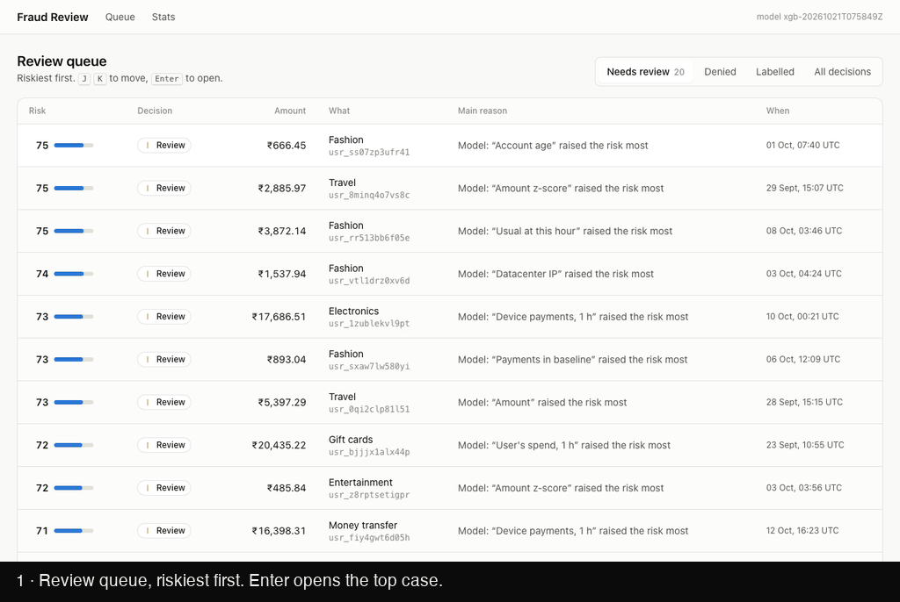

# Building a Real-Time Payment Fraud Engine from Scratch

I work in fraud and risk operations, where most of the job is looking at a suspicious
transaction and deciding, quickly, whether it is what it looks like. This project is the
system I would want behind that work: one that scores every payment in milliseconds,
explains each decision in terms an analyst can check, and gets better from the analyst's
verdicts. It is built from scratch, in seven milestones, and every number below was measured
on the code in this repository.



## The shape of it

A payment (or a card being added to an account) arrives at a FastAPI service, is written to
Postgres, and is published to a Redis stream. A worker reads the stream in order and, for
each event:

1. computes 35 signals from Redis state: velocity, the user's own spending baseline, travel
   speed, device and card age;
2. runs ten YAML rules that encode known attacks;
3. scores the event with an XGBoost model and explains the score with SHAP;
4. combines the two into ALLOW, REVIEW or DENY, and writes the decision, its reasons and its
   timings to an audit log.

Reviews land in a Next.js dashboard, and the analyst's verdicts go back into training.

One worker makes **730 decisions per second**. At a steady 100 events per second the time
from the API publishing an event to the decision being made is **3.2 ms at p95**, against a
100 ms budget.

## Data: the day the model scored a perfect 1.0

No public dataset has card-added events, device ids, geolocation and BINs together, so the
engine comes with a generator: 500 synthetic customers over 30 days, about 35,000 events, 5%
of them fraud across five attack patterns (card testing, CVV brute force, impossible travel,
amount spikes, account takeover). Ground-truth labels go to a separate file and never travel
with the events, so the engine cannot accidentally learn from them.

The first model scored an AUC of **1.000** on held-out data, with zero false positives. That
is not a result; it is a bug report. The top feature explained it: every attack used a
brand-new device, and genuine customers almost never changed theirs. One feature gave the
label away.

Real traffic is messier, so the generator now is too. Genuine customers replace phones,
browse through VPNs, travel abroad, retry after insufficient funds and add a spouse's card
whose name doesn't match. A third of account takeovers happen on the victim's *own* phone and
home connection, the way remote-access malware works. Card-testing rings sometimes rent
residential proxies. And some fraud is *friendly fraud*: a genuine purchase the cardholder
later disputes, which no model can see and which caps achievable recall, as it does in real
data. After that change the model scored 0.984, which is believable.

## Signals, in event time

Each signal is computed from Redis sorted sets whose scores are the events' own timestamps.
"Payments on this card in the last five minutes" is a `ZCOUNT` over the five minutes before
*this* payment, never before the wall clock. That one decision makes replays exact: running
last month's events through the engine again produces the same vectors they had live, which
is what makes the audit log trustworthy and training data free of time-travel leaks.

A few details that took the most care:

- **Baselines are read before they are updated.** The amount z-score compares a payment with
  the user's history, not with a history that already contains it.
- **Idempotency.** If the worker crashes after computing an event but before acknowledging
  it, Redis delivers it again. Velocity set members are event ids, so re-adding them is a
  no-op, and the computed vector is cached per event, so baselines aren't counted twice.
- **Out-of-order events and skewed clocks.** Travel speed uses the absolute time gap with a
  one-minute floor, first-seen times only ever move earlier, and a card's age can't be
  negative because the phone's clock is 30 seconds behind.
- **Log-scale amounts.** Spending is heavy-tailed: one electronics purchase inflates a raw
  standard deviation so much that real spikes vanish. On log amounts they stand out.

Feature computation takes 2.5 ms at p50 and 4.9 ms at p95, two Redis round trips per event.
[Every signal is documented here](signals.md).

## Rules an analyst can read

Rules live in a YAML file:

```yaml
- id: R003
  name: CVV brute force
  condition: card_failed_attempts_1h >= 5 and payment_approved
  action: DENY
  weight: 95
  reason: "Approved after {card_failed_attempts_1h} declined attempts on this card within an hour"
```

Conditions are parsed with Python's `ast` module and every node is checked against an
allow-list (comparisons, `and` / `or` / `not`, feature names, literals) before being compiled
into plain closures. Nothing reaches `eval()`, so a rules file can't run code, and a typo in
a feature name fails when the file loads, not silently at 3 a.m. The file is hot-reloaded; a
broken edit is logged and the last good ruleset keeps running. (A small trap found on the
way: YAML 1.1 reads `Off`, `No` and `Yes` as booleans, so a rule named "Off" broke the loader.
The rules loader now treats only `true` and `false` as booleans.)

The six starter rules from my plan caught **74.3%** of fraud. Reading what they got wrong was
more useful than any tuning:

- Most false alarms from the impossible-travel rule were **genuine cardholders paying at
  home, minutes after a fraudster used their cloned card abroad**. Relative to the fraud, the
  genuine purchase *is* impossible travel. The rule was right that the card was compromised;
  denying the real customer was the wrong call. The rule is now split: travel to a new device
  or country is denied, travel back to a familiar device and country goes to review.
- "Four cards on one device" also fired on people who simply own four cards. It now needs a
  device first seen in the last 72 hours, which is what a carding rig looks like.
- The misses shared one fingerprint: a new device combined with a new country and a
  foreign-issued card, repeated declines, or a cardholder name that didn't match.

With those changes the rules flag **90.9%** of fraud at a **0.17%** false-positive rate, and
only **0.01%** of genuine events are denied outright.

## A model that has to earn its place

The model is XGBoost on the same vectors the rules see, with three decisions that matter more
than the algorithm:

- **Split by time, not at random.** It trains on the oldest 60% of events, is calibrated on
  the next 20%, and every reported number comes from the newest 20%. A random split lets the
  model see attacks from the same week in training and test; a time split is how it would
  actually be deployed.
- **Calibrated scores.** Fraud is 5% of events, so `scale_pos_weight` (about 19) stops the
  model from calling everything legitimate, but it also inflates raw probabilities on purpose.
  Platt scaling on the calibration period maps them back, so the 0–100 score and its
  thresholds (40 review, 75 deny) mean something. Events scored 90 or more were all fraud;
  events scored 5–20 averaged 8.4 and were 9.4% fraud.
- **Explanations with every score.** XGBoost has TreeSHAP built in, so each decision carries
  the five features that moved its score, exact and additive, without the `shap` package.

On the 7,085 held-out events: **AUC 0.984, PR-AUC 0.941, 90.2% recall at a 0.01%
false-positive rate**, and 0.33 ms to score one event including its explanation. Of the 316
fraudulent events in that period, 23 are friendly fraud that nothing can catch, so the ceiling
is about 92.7%. The rules alone reach 87.0% on the same events. The model's advantage is
concentrated where rules are blind: account takeovers, 83% against the rules' 69% (a small
sample, 42 events), most of them on the victim's own phone, where device, IP and location all
look normal and only the pattern of amounts, categories and timing gives it away.

The model never overrides the rules downwards. A rule DENY always wins; a score above 75
denies on its own; a rule REVIEW or a score of 40 or more goes to an analyst, and a low score
never cancels a rule's review.

For the day there are no labels at all, an Isolation Forest scores how *unusual* an event is
instead. It never saw a label and still reaches an AUC of 0.967, but catches only 63% of fraud
at the review threshold: a fallback, not a replacement.

## Decisions you can re-derive

Every decision row stores the fired rules with their reasons, the model score and SHAP values,
the ruleset version, the model version, the thresholds in force and per-stage timings. Each
ruleset version used is saved in its own table and model versions stay on disk, so
`fraud-engine audit` can re-run any stored feature vector through exactly the rules, model and
thresholds that decided it, and compare. On the containerised stack, **33,000 of 33,000
decisions** came out identical; tampering with one stored decision is caught by name.

Measuring latency honestly needed one more idea. A Redis stream id starts with the
millisecond it was published, so the worker records how long each event *waited* as well as
how long it *took*. When I replayed 30,000 events in one burst, events queued for up to 40
seconds behind the backlog, while processing each one still took about 1.5 ms. Those are two
different problems (throughput and latency), and a single "latency" number would have hidden
which one I had.

## The analyst in the loop

The dashboard is designed around one target: triage a case in under 30 seconds. The case view
puts the *why* first (the fired rules in plain sentences, then the risk score against its
thresholds, then the five features that moved it) and the customer's last ten events beside
it, so "first payment abroad, 9,000 km/h from home, on a device first seen an hour ago" reads
in one glance. Everything is on the keyboard: F confirms fraud, L marks it legitimate, and the
next riskiest case opens immediately. The system's share of each case is about 9 ms; the rest
is reading.

Labels are stored by source. An analyst's verdict sits beside ground truth (in production,
chargebacks) instead of overwriting it, training uses the analyst's label when there is one,
and the case view never shows ground truth, which would make triage meaningless.

`fraud-engine retrain` closes the loop: it trains a challenger on the latest labels, scores it
and the model in use on the same held-out events, writes a comparison report, and promotes the
challenger only if its PR-AUC is strictly higher. Starting from the label-free Isolation Forest,
a simulated analyst worked the 109-case queue (49% of reviewed cases were fraud), and the
retrained model was promoted: recall at the review threshold went from **63% to 90%**, and at
the deny threshold from **27% to 90%**. Re-running retrain with nothing new produces an
identical model, because training is deterministic, and the report says to keep the current
one.

## What it doesn't do yet

- **Real data.** Synthetic attacks are cleaner than real ones, so these numbers are an upper
  bound. The next step is the IEEE-CIS dataset, which lacks some of these signals but has real
  messiness.
- **Graph signals.** Shared devices, IPs and cards between accounts are how fraud rings are
  found; this engine looks at one account at a time.
- **Concurrency.** Feature state is updated in two round trips, so two workers handling the
  same user at the same instant could race. One worker handles 730 events per second; beyond
  that the stream needs sharding by user, or the update moves into a Redis Lua script.
- **Auth and rate limiting** on the API, and shadow mode for new rules and models.

## What I'd tell myself at the start

1. **A perfect score is a bug report.** Check what the model is leaning on before celebrating.
2. **Read the false alarms.** The most valuable rule change came from noticing that the
   "fraud" being flagged was the real customer.
3. **Use event time everywhere.** It makes replays exact, audits possible and training honest.
4. **Separate waiting from working.** Throughput and latency fail for different reasons.
5. **Make the decision re-derivable, not just logged.** Storing what happened is easy;
   proving you can reproduce it is what makes the log an audit trail.
